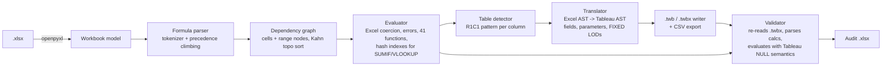

# xl2tableau

A command-line tool that moves the logic of an Excel model into Tableau. It reads an
`.xlsx` file, recalculates every formula with its own engine, finds the tables, and
turns each calculated column into a Tableau calculated field. The output is a packaged
workbook (`.twbx`) with CSV data, Tableau parameters and calculated fields, plus an Excel
audit report.

Each translated field is then checked row by row. The tool reads the `.twbx` back from
disk, evaluates every calculated field over the CSV, and compares each row with the value
the Excel engine computed for the same cell. A translation that gives a different answer
on any row is reported, along with the row number.

Example: this Excel column

```
Region Revenue   =SUMIF($A$2:$A$201,A2,$F$2:$F$201)
Share            =F2/SUM($F$2:$F$201)
Tax              =F2*TaxRate                 (TaxRate is a defined name on another sheet)
```

becomes these Tableau calculations:

```
{FIXED [Region] : SUM([Revenue])}
[Revenue] / {FIXED : SUM([Revenue])}
[Revenue] * [Parameters].[TaxRate]
```

## Running it

Requires Python 3.10 or newer. The only runtime dependency is `openpyxl`.

```bash
pip install -e ".[test]"
python examples/make_example.py                     # writes examples/sales_model.xlsx (already committed)
xl2tableau convert examples/sales_model.xlsx -o out
xl2tableau eval examples/sales_model.xlsx --sheet Assumptions   # print recalculated values
pytest -q
python bench/run_bench.py                           # full benchmark (about 75 s)
python bench/run_bench.py --quick                   # what CI runs
```

`xl2tableau convert --strict` exits with status 1 if any translated field disagrees
with Excel on any row.

Output of `xl2tableau convert examples/sales_model.xlsx -o out`. The example contains
one deliberately hardcoded cell (`Tax` in row 9 is typed in as 12.5 instead of the formula):

```
table 'Sales' on sheet 'Sales': 200 rows, 17 columns
  Revenue                  ok 200/200 rows agree
  Tax                      DIFFERS 199/200 rows agree
                           1 cells differ from the column formula
  Tier                     ok 200/200 rows agree
  Share                    ok 200/200 rows agree
  Region Revenue           ok 200/200 rows agree
  Region Share             ok 200/200 rows agree
  Label                    ok 200/200 rows agree
  Margin                   DIFFERS 199/200 rows agree
  Code                     ok 200/200 rows agree
  Region Product Units     ok 200/200 rows agree
  List Price               MANUAL: VLOOKUP needs a Tableau relationship or join to the lookup range
  Running Total            MANUAL: refers to another row (Q2); running totals and offsets need Tableau table calculations
                           1 cells differ from the column formula
table 'Products' on sheet 'Products': 5 rows, 2 columns
translated 10/12 calculated columns; 1998/2000 checked rows agree with Excel
```

The hardcoded value is caught twice: the pattern check flags the cell, and the row check
shows that `Tax` and `Margin` (which depends on `Tax` in Excel) disagree at row 9. Tableau
recomputes the formula for every row, so it would silently "fix" that cell, and this is the
kind of difference a migration should surface.

The files written to `out/`:

| file | contents |
|---|---|
| `sales_model.twbx` | packaged workbook: `.twb` XML plus `Data/*.csv` |
| `sales_model.twb`, `Data/` | the same, unpacked |
| `sales_model_audit.xlsx` | `Summary` (live `COUNTIF`/`SUM`/`IFERROR` formulas), `Fields` (an Excel table with every column's formula, R1C1 pattern, Tableau calc, status and row counts), `Parameters`, `Inconsistencies`, `Mismatches` |

## Architecture



| module | role |
|---|---|
| `formula/parser.py` | tokenizer and parser. Handles Excel precedence (`-2^2 = 4`, left-associative `^`), sheet-qualified and whole-column refs, defined names |
| `formula/values.py` | Excel value model: coercion, mixed-type comparison order, half-away-from-zero `ROUND`, SUMIF criteria (`">=10"`, `"East*"`, `"<>x"`) |
| `formula/functions.py` | function library, including hash-indexed `SUMIF(S)`/`COUNTIF(S)`/`AVERAGEIF`, `VLOOKUP`, `MATCH` |
| `engine.py` | workbook model, dependency graph, topological recalculation, cycle detection, implicit intersection |
| `tables.py` | table detection (Excel table objects first, then a heuristic) and R1C1 pattern analysis |
| `tableau/translate.py` | Excel-to-Tableau translation with type checking and a reason for every failure |
| `tableau/calc.py` | Tableau calc AST, renderer, parser and evaluator (NULL propagation, `IF/ELSEIF`, FIXED LODs) |
| `tableau/twb.py` | `.twb` XML (federated datasource over a textscan/CSV connection, parameters, calculated fields, starter worksheet), `.twbx` packaging, reading both back |
| `validate.py` | row-by-row comparison of the Tableau model against the Excel engine |
| `audit.py` | Excel audit report |

### Design choices

- **Range nodes in the dependency graph.** When 50,000 rows each reference `$F$2:$F$50001`,
  adding an edge from every cell in the range to every dependent would create 2.5 billion
  edges. Instead each distinct range is one node that depends on the formula cells inside it,
  so the graph stays linear in size. Evaluation follows Kahn's algorithm, so a 20,000-cell
  running-total chain evaluates without recursion (there is a test for it).
- **Criteria hash index.** `SUMIF($A:$A, A2, $F:$F)` in every row is O(N²) if each call
  scans the column. The engine builds one hash map per (criteria ranges, sum range) per
  recalculation and answers each call with one lookup. Plain `SUM` over a range is memoised the
  same way. A randomized test checks that the indexed path and the linear scan return identical
  values, including mixed types, numeric text and blanks.
- **R1C1 patterns.** `=C2*D2` in row 2 and `=C3*D3` in row 3 both normalise to
  `(RC[-2]*RC[-1])`. The most common pattern in a column is its formula; any cell that differs
  (a typed-over value, an edited formula) is listed in the audit.
- **Semantic gaps are translated explicitly, not ignored.** Excel treats a blank as 0, Tableau
  treats it as NULL, so nullable numeric fields are wrapped in `ZN()`. Excel `MOD` takes the sign of
  the divisor and Tableau `%` takes the sign of the dividend, so `MOD(a,b)` becomes
  `a - b*FLOOR(a/b)`. Excel `INT` floors and Tableau `INT` truncates, so it becomes `FLOOR`. `&` becomes
  `+` with `STR()` around numbers. `IF` branches with different types are rejected because Tableau
  requires one type.
- **Translations are checked against the files on disk.** The validator parses the formulas
  from the written `.twb` and reads the written CSV with its declared types, so it catches mistakes
  in rendering, escaping and CSV typing as well as in the translation.

## Benchmark results

Produced by `python bench/run_bench.py` on an Apple Silicon Mac (Darwin arm64), Python 3.12.14,
single thread. The workbook is the generated sales model: 5 data columns and 12 formula columns
per row (arithmetic, defined-name parameter, nested `IF`, `SUM` over a column, `SUMIF`, `SUMIFS`,
`IFERROR(ROUND(...))`, text functions, `MOD`, `VLOOKUP`, running total). "Accuracy" compares
every engine result with values computed directly in Python, without the engine
(`sample.expected_values`).

**Recalculation (hash indexes and aggregate memo on), best of 3**

| rows | formulas | parse s | graph s | eval s | total s | formulas/s | accuracy vs ground truth |
|---:|---:|---:|---:|---:|---:|---:|---:|
| 1,000 | 12,000 | 0.186 | 0.027 | 0.049 | 0.260 | 46,120 | 12,000/12,000 |
| 10,000 | 120,000 | 2.134 | 0.300 | 0.509 | 2.945 | 40,749 | 120,000/120,000 |
| 50,000 | 600,000 | 10.963 | 1.708 | 2.703 | 15.102 | 39,729 | 600,000/600,000 |

Throughput stays roughly flat from 12,000 to 600,000 formulas, so the per-row `SUMIF`/`SUMIFS`/`SUM`
columns are not causing quadratic cost. Parsing takes about 70% of the time.

**Effect of the criteria hash index and aggregate memo**

| rows | caches off s | caches on s | speedup |
|---:|---:|---:|---:|
| 500 | 0.560 | 0.120 | 4.7x |
| 1,000 | 2.038 | 0.240 | 8.5x |
| 2,000 | 8.125 | 0.490 | 16.6x |

Without the caches, time grows about 4x each time the rows double (quadratic). With them it
grows about 2x (linear).

**Full conversion of a 10,000-row `.xlsx`** (with one hardcoded override at row 9)

| metric | value |
|---|---:|
| wall time (load + recalc + translate + write + validate + audit) | 4.98 s |
| recalc stage | 3.124 s |
| translate stage (includes table detection) | 0.517 s |
| write stage | 0.028 s |
| validate stage | 0.223 s |
| calc columns translated | 10/12 |
| row-level checks agreeing with Excel | 99,998/100,000 |
| cells flagged as differing from their column pattern | 2 |
| .twbx size | 57 KiB |

The two disagreeing rows are the planted override (`Tax`, row 9) and its dependent (`Margin`,
row 9). The two flagged cells are that override and the first row of `Running Total`, whose
formula (`=F2`) differs from the rest of the column (`=Q2+F3`, ...). The two untranslated columns are
`VLOOKUP` and the running total. Raw numbers are in `bench/results.json` and `bench/results.md`.

## Limitations

- **The Tableau side is a model, not Tableau.** The validator evaluates calculations with a
  re-implementation of Tableau's row-level semantics. No licensed software runs in CI, and the
  generated `.twb` has not been opened in Tableau Desktop as part of this repository's tests.
  The XML follows the structure of Tableau's file format (federated datasource, textscan
  connection, `Parameters` datasource, `<calculation class='tableau'>`). Exact `STR()` number
  formatting and string collation can differ by data source.
- **Case sensitivity.** Excel's `=` and `SUMIF` ignore case. Tableau's `==` is case-sensitive for
  most sources. The tool emits `==`. If the data mixes case, the validator reports the affected
  rows (a test covers this). It does not rewrite the comparison with `LOWER()`.
- **Not translated:** lookups (`VLOOKUP`, `INDEX`, `MATCH`, which need a relationship or join),
  references to other rows (running totals and offsets, which need table calculations),
  `SUMIF` whose criterion compares to a different column, mixed-type `IF`, ranges that are not
  exactly one table column, volatile functions, and anything outside the 41 supported functions.
  Each case is reported with a reason.
- **Engine coverage:** dates are read as ISO text (no date serial arithmetic), and there are no
  array formulas, `INDIRECT`/`OFFSET`, R1C1 input, row ranges like `1:3`, or descending `MATCH`. Cells
  in a reference cycle get a `#CIRC!` marker (Excel would show a warning and 0), and so do cells
  downstream of the cycle.
- **Table detection** uses Excel table objects when they exist. Otherwise it takes the first row
  with two or more adjacent text cells as the header, so unusual layouts may need a table object.
- **Performance** is single-threaded pure Python. About 40,000 formulas/s on the machine above is
  fine for audit-sized models but much slower than Excel itself.
